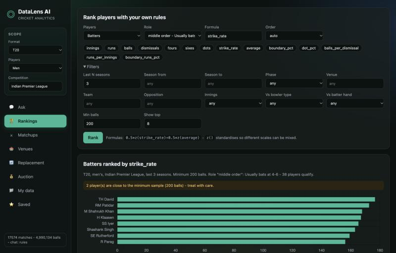
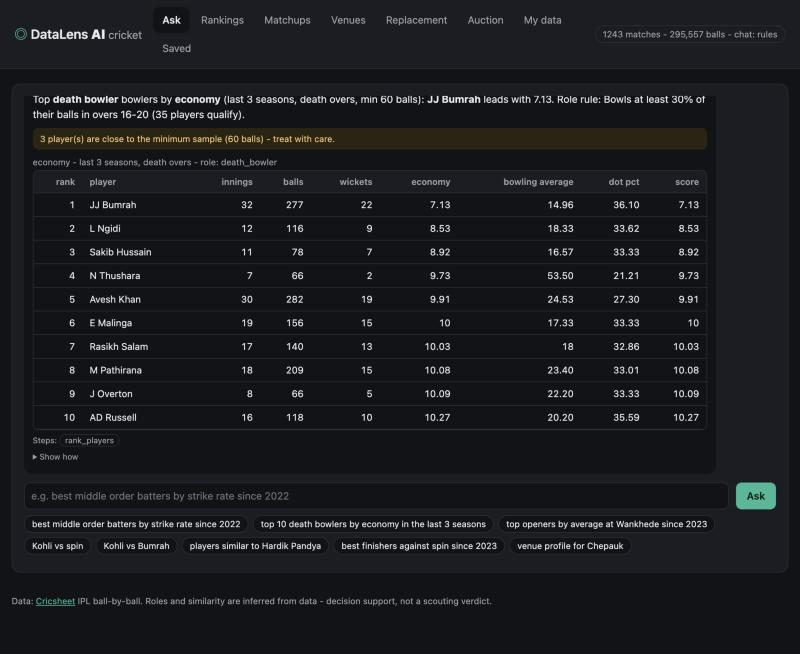

# DataLens AI - cricket analytics with your own rules

Ask questions about ball-by-ball cricket data in plain English, then build **your own** player ratings and rankings instead of living with fixed stats pages. Covers **T20 and ODI cricket, men's and women's** - internationals plus ~30 leagues (IPL, BBL, PSL, CPL, SA20, ILT20, MLC, WBBL, WPL ...).

Built around a real franchise problem: *"We need the best **middle-order** batter by strike rate - and no openers in the list."*



<table>
<tr>
<td width="33%"><br><sub>Ask in plain English; every answer shows its steps</sub></td>
<td width="33%"><br><sub>Batter vs pace / spin with data-coverage warnings</sub></td>
<td width="33%"><br><sub>Best squad within purse, role slots and overseas cap</sub></td>
</tr>
</table>

## What it does

| Feature | How it works |
|---|---|
| **Scope** | Pick format (T20 / ODI), men or women, and optionally a competition (e.g. `IPL`, `BBL`, `International`) once in the sidebar; every tab uses it. Stats are **never mixed across formats or genders**. |
| **Role engine** | Infers roles from the data. Batting: opener (1-2), top order (1-3), middle order (4-6), finisher (4-7 with a big share of balls in the death overs), lower order. Bowling: powerplay / middle-overs / death bowler (share of balls per phase), pacer, spinner. Phases and thresholds adapt to the format (T20 powerplay = overs 1-6, ODI = 1-10). |
| **Custom metrics & rankings** | Write formulas like `0.5*z(strike_rate) + 0.3*z(average) + 0.2*z(boundary_pct)`. Filter by role, season window, phase, venue, team, opposition, innings, bowler type, batter hand and minimum sample. |
| **Chat** | Ask "best middle order batters by strike rate in the IPL since 2022". Shows which tool and query produced every answer. Works offline with a built-in parser; set `ANTHROPIC_API_KEY` for free-form questions (Claude tool-use over the same analytics tools + a guarded read-only SQL tool). |
| **Matchups** | Batter vs pace / spin (and finer bowling styles), bowler vs left / right-handers, batter vs bowler, best and worst opponents. |
| **Venues & conditions** | Scoring, phase run rates, chase/toss tendencies per ground; or filter any ranking to one venue. |
| **Replacement finder** | Statistical-profile similarity (z-scored features, optional weights) with price, nationality and "currently active" filters. |
| **Auction planner** | Pick a tournament and your team -> load your squad -> find role gaps -> exact **MILP** (SciPy/HiGHS) picks the highest-fit buys within purse, role slots and overseas cap, **only from players who are actually available** (not on other teams' squads). Releases, retentions and trades are kept in a yearly roster file. |
| **Your own data** | Upload a CSV (up to 200 MB by default): data-quality score, missing/duplicate/outlier/inconsistency detection, one-click cleaning, guarded SQL, quick charts. |
| **Save & export** | Save ranking setups, export CSV or a printable HTML report. |

## Quick start

```bash
git clone https://github.com/bitmorph2347/datalens-ai && cd datalens-ai
python3 -m venv .venv && source .venv/bin/activate
pip install -r requirements.txt
python -m datalens.loader        # downloads Cricsheet data and builds data/datalens.duckdb (~5 min, ~256 MB)
python -m datalens.api           # http://127.0.0.1:8000   (set PORT=8001 to use another port)
pytest -q                        # 95 tests
```

The loader needs about 1 GB of temporary disk space and deletes the extracted CSVs when it finishes (`--keep-raw` keeps them). For a quick demo with IPL data only (under a minute): `python -m datalens.loader --scope ipl`. The full test suite expects the default `--scope all` data.

**Keeping data fresh:** the database is a snapshot. After more matches have been played, run `python -m datalens.loader --update` (re-downloads Cricsheet data, rebuilds the database, prints how many matches were added) and restart the app. Cricsheet publishes after matches finish, so there is no live-match data. New players need a row in `data/players_meta.csv` to appear in bowler-type / batter-hand filters.

Optional: `export ANTHROPIC_API_KEY=...` to enable free-form chat (model via `DATALENS_MODEL`, default `claude-sonnet-5-5`). `export DATALENS_MAX_UPLOAD_MB=500` to change the upload limit.

## Auction planner: tournaments, teams and yearly updates

1. Set **Competition** in the sidebar (e.g. IPL, SA20, BBL) and open the **Auction** tab.
2. Choose **your team** and click **Load squad**; remove anyone you are releasing.
3. **Find gaps**, set your purse and overseas limit, then **Optimise squad**.

Who is "available"? Cricsheet has match data only, so rosters come from two places (`datalens/rosters.py`):

- **Auto-guess:** a team's squad is everyone who played for it in the tournament's latest season. Players on *other* teams' squads are never suggested. Players seen only before the previous season are skipped (the data can't know about retirements), and every suggestion shows the last season the player appeared in.
- **Roster file** `data/rosters.csv` (template: `docs/rosters.example.csv`): after each retention / release / trade window, save the new squads from the Auction tab ("Save roster") or upload a CSV with columns `competition,season,team,player,status` (`retained` or `released`). A team with retained rows in the newest season of the file uses them instead of the auto-guess; `released` players are free to buy; a trade is a `retained` row under the new team. The two text boxes in the tab cover quick edits: *Released / free players* and *Not available* (signed elsewhere, retired, injured).

Each year: run `python -m datalens.loader --update` for new matches, then update the rosters. Prices still come from the price list (sample prices are synthetic - upload real ones), and only priced players can be suggested. The Hundred is not covered (different structure; see limitations).

## The headline example

"Best middle-order batters by strike rate in the IPL, last 3 seasons":

```python
from datalens.engine import Engine
Engine().rank("bat", role="middle_order", formula="strike_rate",
              filters={"competition": "ipl", "last_n_seasons": 3}, min_balls=200)
```

1. Batting position is derived per innings from the order batters arrive at the crease.
2. A player is "middle order" if they bat at 4-6 in at least 60% of their innings in the window - so openers drop out automatically.
3. Strike rate is computed only over qualifying players and the filtered deliveries, with a minimum-balls guard and small-sample warnings.

Change `format` to `"ODI"`, `gender` to `"female"` or `competition` to `"Big Bash League"` and the same question works there.

## Formula language

Metrics (batting): `runs balls innings dismissals fours sixes strike_rate average boundary_pct dot_pct balls_per_dismissal runs_per_innings boundary_runs_pct`
Metrics (bowling): `balls overs runs wickets economy bowling_average bowling_sr dot_pct boundary_pct wickets_per_over wides noballs`
Phase metrics: prefix any of `balls strike_rate boundary_pct dot_pct` (batting) or `balls wickets economy dot_pct wickets_per_over` (bowling) with `pp_`, `mid_` or `death_` - e.g. `0.5*z(death_economy) - 0.3*z(death_wickets)`. They are blank (the player drops out) below 12 balls in that phase.
Functions: `z(x)` z-score, `pctile(x)` percentile, `abs sqrt log min max round`, operators `+ - * / **`.

Formulas are parsed with Python's `ast` and compiled to SQL from a whitelist - no raw user SQL ever reaches the database, and division is zero-safe.

## Architecture

```
Cricsheet CSVs -> loader.py -> DuckDB (balls, matches, bat_pos, players_meta)
                                   |
   formula.py (safe compiler) --> engine.py (scope, roles, rankings, matchups, venues, squad gaps)
                                   |-- similarity.py   (replacement finder)
                                   |-- budget.py       (MILP auction optimiser)
                                   |-- chat.py         (Claude tool-use or rules parser -> same tools)
                                   `-- uploads.py      (profile / clean / query user CSVs)
                                   |
                              api.py (FastAPI)  ->  web/ (vanilla JS + Chart.js, no build step)
```

Safety notes: the analytics DB is opened **read-only with external file access disabled**; the SQL tool accepts a single `SELECT`/`WITH` and rejects DDL/DML/file functions; uploads live in a separate in-memory DuckDB.

## Engineering highlights

- **Correctness checked against independent SQL:** 95 tests verify strike rate, economy, head-to-head and pace/spin totals against separate calculations, role rules (no openers in the middle-order list), per-format phase boundaries, gender/format separation, optimiser constraints and the API.
- **Safe by construction:** user formulas compile from an AST whitelist; read-only database; SQL tool limited to one `SELECT`.
- **Honest analytics:** minimum-sample guards, small-sample flags, and explicit coverage warnings when player metadata is incomplete.
- **Entity resolution:** team, competition and venue renames are merged (e.g. Delhi Daredevils -> Delhi Capitals, NatWest T20 Blast -> Vitality Blast) and free-text player names resolve to Cricsheet names (`Rohit Sharma` -> `RG Sharma`), preferring the well-known player over namesakes.
- **Exact optimisation:** the auction planner solves a mixed-integer program rather than a greedy pick.
- **Robust data build:** atomic (a failed build never leaves a broken database), batched file reads (works under macOS's 256 open-file limit), non-numeric match ids handled.

## Data & honest limitations

- **Source:** ball-by-ball data from [Cricsheet](https://cricsheet.org) (please see their site for licence/attribution terms; raw data is not redistributed here - the loader downloads it).
- **Included:** 6-ball T20 (20 overs) and ODI (50 overs) matches - about 17,500 matches / 5 million deliveries: men's and women's internationals plus ~30 club leagues. **Not included:** Tests and other multi-day cricket, domestic one-day cricket, and The Hundred (different structure, so phases would mean something else).
- **Roles are inferred**, not official labels. Players with few innings may have no role.
- **Player names:** Cricsheet uses `initials surname` names; two different players with the same name would be merged.
- **`data/players_meta.csv` is hand-curated** (batting hand, bowling style) for ~420 players (IPL regulars plus leading international men and women). Matchup filters by bowler type / batter hand only cover deliveries whose bowler/batter is in that file - results report the coverage and mark the rest "unknown" (coverage is much lower outside the IPL). Contributions welcome.
- **Nationality** (`IND` vs `OS`, used for overseas caps) is derived from the national team a player has represented, so players who never played internationals show `UNK`.
- **`data/prices_sample.csv` is synthetic and illustrative only** (derived from recent IPL performance, *not* real auction prices). Upload your own price list in the Auction tab (`player,price_cr[,nationality]`; names are fuzzy-matched).
- Venue-name merging is hand-written for IPL grounds; other leagues' grounds appear under Cricsheet's own names.
- Similarity and role-fit are statistical decision support. They ignore age, fitness, pitch/weather and team context.
- Small samples are flagged but not "fixed" - ball-level cricket data is noisy.

## Continuous integration

A ready-made GitHub Actions workflow is in `docs/ci.yml.example` (installs deps, builds the DB from Cricsheet, runs the tests). Copy it to `.github/workflows/ci.yml` to enable it.

## Roadmap

Tests / multi-day cricket, prediction lab (form forecasts, matchup models, win probability with calibrated uncertainty), what-if simulations, real auction-price and age data, more leagues and other sports.

## License

MIT (code). Data belongs to Cricsheet under its own terms.
