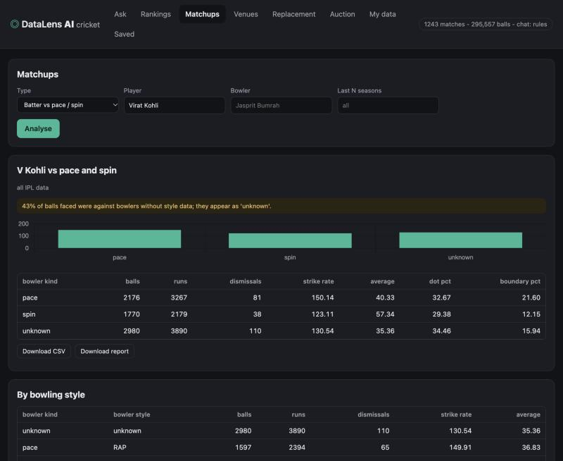
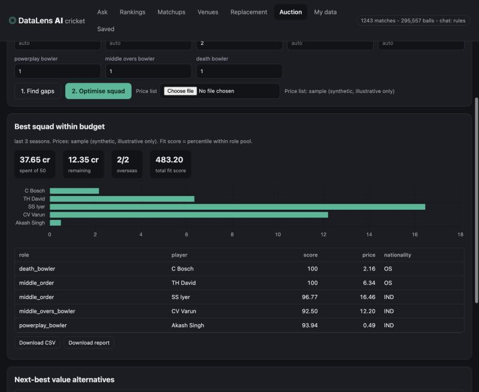

# DataLens AI - cricket analytics with your own rules

Ask questions about IPL ball-by-ball data in plain English, then build **your own** player ratings and rankings instead of living with fixed stats pages. Built around a real franchise problem: *"We need the best **middle-order** batter by strike rate - and no openers in the list."*


<table>
<tr>
<td width="33%"><br><sub>Ask in plain English; every answer shows its steps</sub></td>
<td width="33%"><br><sub>Batter vs pace / spin with data-coverage warnings</sub></td>
<td width="33%"><br><sub>Best squad within purse, role slots and overseas cap</sub></td>
</tr>
</table>

## What it does

| Feature | How it works |
|---|---|
| **Role engine** | Infers roles from the data. Batting: opener (1-2), top order (1-3), middle order (4-6), finisher (4-7 with a big share of balls in overs 16-20), lower order. Bowling: powerplay / middle-overs / death bowler (share of balls per phase), pacer, spinner. A player can hold several roles; thresholds are adjustable. |
| **Custom metrics & rankings** | Write formulas like `0.5*z(strike_rate) + 0.3*z(average) + 0.2*z(boundary_pct)`. Filter by role, season window, phase, venue, team, opposition, innings, bowler type, batter hand and minimum sample. |
| **Chat** | Ask "best middle order batters by strike rate since 2022". Shows which tool and query produced every answer. Works offline with a built-in parser; set `ANTHROPIC_API_KEY` for free-form questions (Claude tool-use over the same analytics tools + a guarded read-only SQL tool). |
| **Matchups** | Batter vs pace / spin (and finer bowling styles), bowler vs left / right-handers, batter vs bowler, best and worst opponents. |
| **Venues & conditions** | Venue-normalised scoring, phase run rates, chase/toss tendencies; or filter any ranking to one ground. |
| **Replacement finder** | Statistical-profile similarity (z-scored features, optional weights) with price, nationality and "currently active" filters. |
| **Auction planner** | Enter your squad -> find role gaps -> exact **MILP** (SciPy/HiGHS) picks the highest-fit buys within purse, role slots and overseas cap. |
| **Your own data** | Upload a CSV: data-quality score, missing/duplicate/outlier/inconsistency detection, one-click cleaning, guarded SQL, quick charts. |
| **Save & export** | Save ranking setups, export CSV or a printable HTML report. |

## Engineering highlights

- **Correctness checked against independent SQL:** 81 tests verify strike rate, economy, head-to-head and pace/spin totals against separate calculations, plus role rules (no openers in the middle-order list), constraint satisfaction in the optimiser and the API.
- **Safe by construction:** user formulas compile from an AST whitelist; the analytics database is read-only with file access disabled; the SQL tool rejects anything but a single `SELECT`.
- **Honest analytics:** minimum-sample guards, small-sample flags, and explicit coverage warnings when metadata is incomplete.
- **Entity resolution:** team and venue renames are merged (e.g. Delhi Daredevils -> Delhi Capitals, Kotla -> Arun Jaitley Stadium) and free-text player names resolve to Cricsheet names (`Rohit Sharma` -> `RG Sharma`).
- **Exact optimisation:** the auction planner solves a mixed-integer program rather than a greedy pick.

## Quick start

```bash
git clone https://github.com/bitmorph2347/datalens-ai && cd datalens-ai
python3 -m venv .venv && source .venv/bin/activate
pip install -r requirements.txt
python -m datalens.loader        # downloads Cricsheet IPL data and builds data/datalens.duckdb (~1 min)
python -m datalens.api           # http://127.0.0.1:8000
pytest -q                        # 81 tests
```

Optional: `export ANTHROPIC_API_KEY=...` to enable free-form chat (model via `DATALENS_MODEL`, default `claude-sonnet-5-5`).

## The headline example

"Best middle-order batters by strike rate, last 3 seasons":

```python
from datalens.engine import Engine
Engine().rank("bat", role="middle_order", formula="strike_rate",
              filters={"last_n_seasons": 3}, min_balls=200)
```

1. Batting position is derived per innings from the order batters arrive at the crease.
2. A player is "middle order" if they bat at 4-6 in at least 60% of their innings in the window - so openers drop out automatically.
3. Strike rate is computed only over qualifying players and the filtered deliveries, with a minimum-balls guard and small-sample warnings.

Other examples: `top 10 death bowlers by economy in the last 3 seasons`, `best finishers against spin since 2023`, `Kohli vs Bumrah`, `players similar to Hardik Pandya`.

## Formula language

Metrics (batting): `runs balls innings dismissals fours sixes strike_rate average boundary_pct dot_pct balls_per_dismissal runs_per_innings boundary_runs_pct`
Metrics (bowling): `balls overs runs wickets economy bowling_average bowling_sr dot_pct boundary_pct wickets_per_over wides noballs`
Functions: `z(x)` z-score, `pctile(x)` percentile, `abs sqrt log min max round`, operators `+ - * / **`.

Formulas are parsed with Python's `ast` and compiled to SQL from a whitelist - no raw user SQL ever reaches the database, and division is zero-safe.

## Architecture

```
Cricsheet CSVs -> loader.py -> DuckDB (balls, matches, bat_pos, players_meta)
                                   |
   formula.py (safe compiler) --> engine.py (roles, rankings, matchups, venues, squad gaps)
                                   |-- similarity.py   (replacement finder)
                                   |-- budget.py       (MILP auction optimiser)
                                   |-- chat.py         (Claude tool-use or rules parser -> same tools)
                                   `-- uploads.py      (profile / clean / query user CSVs)
                                   |
                              api.py (FastAPI)  ->  web/ (vanilla JS + Chart.js, no build step)
```

Safety notes: the analytics DB is opened **read-only with external file access disabled**; the SQL tool accepts a single `SELECT`/`WITH` and rejects DDL/DML/file functions; uploads live in a separate in-memory DuckDB.

## Data & honest limitations

- **Source:** ball-by-ball IPL data from [Cricsheet](https://cricsheet.org) (please see their site for licence/attribution terms; raw data is not redistributed here - the loader downloads it).
- **Roles are inferred**, not official labels. Players with few innings may have no role.
- **`data/players_meta.csv` is hand-curated** (batting hand, bowling style, nationality) for ~210 players active in recent seasons. Matchup filters by bowler type/batter hand only cover deliveries whose bowler/batter is in that file - results report the coverage and mark the rest "unknown". Contributions welcome.
- **`data/prices_sample.csv` is synthetic and illustrative only** (derived from recent performance, *not* real auction prices). Upload your own price list in the Auction tab (`player,price_cr[,nationality]`; names are fuzzy-matched).
- Similarity and role-fit are statistical decision support. They ignore age, fitness, pitch/weather and team context.
- Small samples are flagged but not "fixed" - ball-level cricket data is noisy.

## Continuous integration

A ready-made GitHub Actions workflow is in `docs/ci.yml.example` (installs deps, builds the DB from Cricsheet, runs the tests). Copy it to `.github/workflows/ci.yml` to enable it.

## Roadmap

Prediction lab (form forecasts, matchup models, win probability with calibrated uncertainty), what-if simulations, auction-price and age data, other leagues and sports.

## License

MIT (code). Data belongs to Cricsheet under its own terms.
